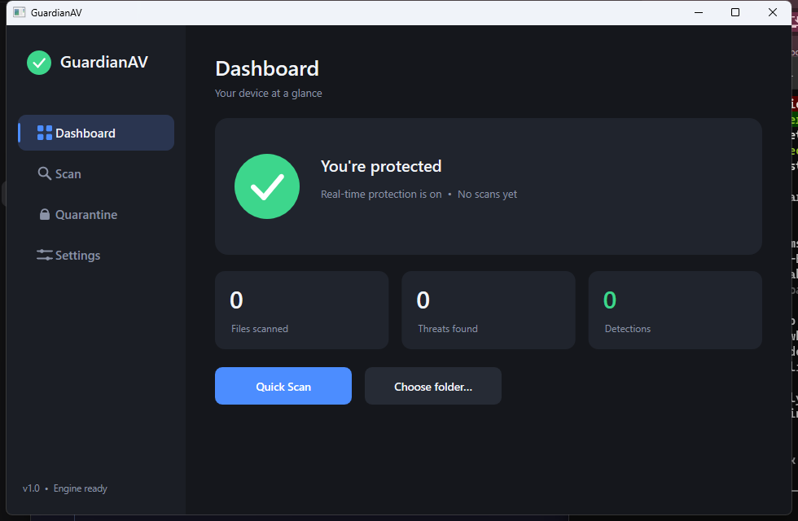
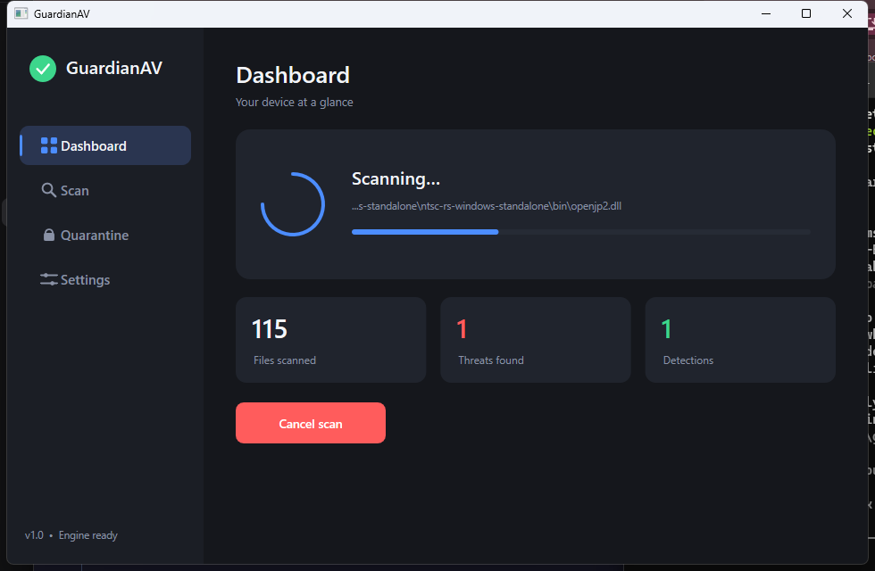
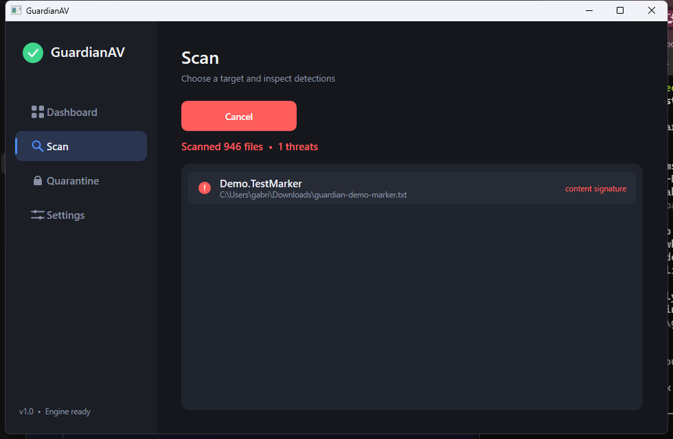
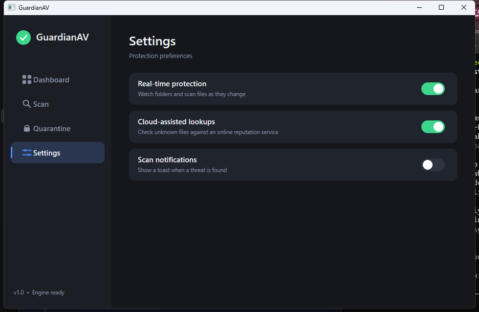
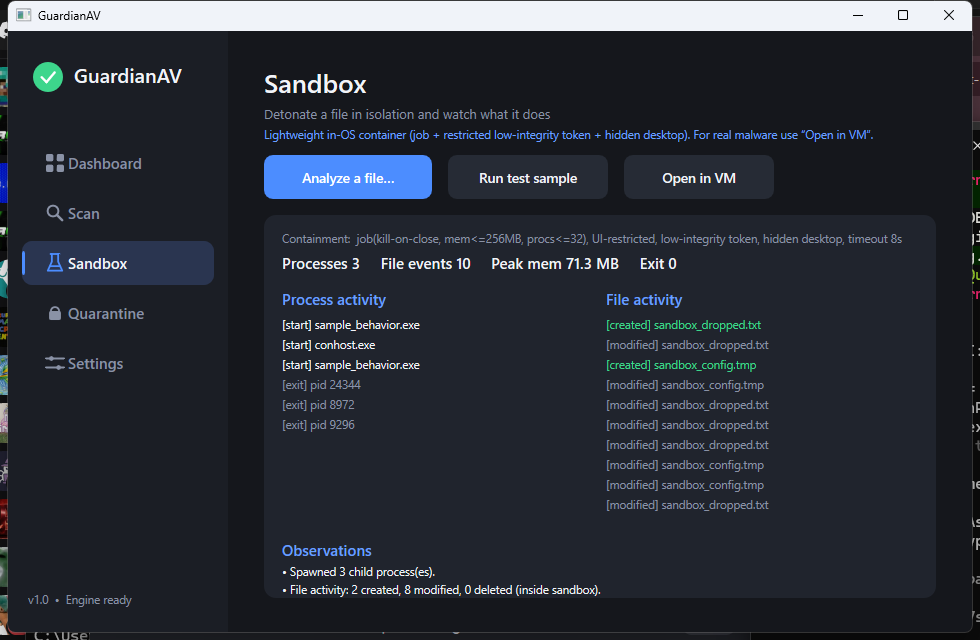

# Aegis

**Advanced Endpoint Guardian for Inspection & Sandboxing**

Antivírus e laboratório de inspeção/sandbox em C/C++, com implementação própria
do convidado. O produto mantém Windows/MSVC/WHP e validação nativa Linux/KVM.
Os nomes dos executáveis `guardian-*` permanecem compatíveis.

O lote de componentes COM/RPC, Shell e controles do MiniNT está descrito na
[entrega delimitada da fase 14.8](docs/PHASE-14.8.md), com critérios de aceitação
e limitações explícitos.

A fase 14.9 acrescenta rede contida, HTTP, TLS 1.2 no convidado, CNG e lojas
virtuais de chaves/certificados: [escopo e validação](docs/PHASE-14.9.md).
A implementação atende um corpus delimitado de Windows 10 x64.

A 12F acrescenta o modo opcional de janelas independentes no desktop Windows,
com conteúdo rasterizado pelo MiniNT e entrada restrita à sessão:
[implementação, uso e limites](docs/PHASE-12F.md).
A **14.10A** acrescenta a primeira ponte de comandos e desenho GDI por um
auxiliar restrito do Windows: [escopo, uso e limites](docs/PHASE-14.10A.md).
A **14.10B** acrescenta imports USER32 próprios, janelas e controles BUTTON/STATIC/EDIT reais com callbacks no MiniNT: [contrato e testes](docs/PHASE-14.10B.md).
A **14.10C** acrescenta desenho GDI, fontes e bitmaps executados pelo Windows,
com comparação da mesma aplicação no MiniNT e nativamente: [contrato e testes](docs/PHASE-14.10C.md).
A **14.10D** acrescenta controles, menus, diálogos no namespace convidado e
aceitação do Flappy com GUI nativa: [contrato e testes](docs/PHASE-14.10D.md).
A **14.10E** amplia curvas, regiões, paths, transformações, bitmaps e texto em janelas do host, com corpus independente e matriz de APIs: [contrato e testes](docs/PHASE-14.10E.md).
A **14.10F** acrescenta Direct2D/DirectWrite por software, PNG/BMP/JPEG e
operações limitadas de texturas D3D11 WARP/DXGI:
[contratos, testes e pendências](docs/PHASE-14.10F.md).
Shaders, pipeline 3D e DirectX completo permanecem pendentes.

A entrega inicial da **14.11** acrescenta CIL de console limitado, contratos
WinRT escalares e instalação portátil no convidado:
[escopo, reprodução e pendências](docs/PHASE-14.11.md).
O lote seguinte acrescenta Form, Button, Label e TextBox selecionados, com
janelas/controles reais no Windows e eventos interpretados no MiniNT.
CLR e WinForms completos, WPF, WinUI e instaladores MSI continuam pendentes.

Repositório público com fontes, testes, configuração e documentação. Builds,
releases, executáveis e discos virtuais ficam fora do Git. Alguns testes exigem
recriar seus dados compilados: [preparação a partir dos fontes](docs/GITHUB-AEGIS.md).

Para gerenciar Git, repositórios, branches e PRs:

```text
python tools/aegis_git.py
```

O menu também gera revisões de testes de isolamento e consistência do sandbox.
Elas preservam erros reais e relatórios; não prometem indetectabilidade.
[Automação e uso](docs/GITHUB-AEGIS.md) · [Segurança](SECURITY.md) ·
[Estado atual e limites](docs/PHASE-13.md) · [Roadmap](docs/ROADMAP-COMPLETO.md)

**Revisão Windows em 23/10/2026:** as fases 12B–13 receberam correções e passaram
na matriz MSVC/WHP: **80 testes distintos Debug**, com retestes documentados,
e **80/80 Release** em uma suíte completa, sem ignorados.
[Correções, evidências e limites](docs/REVISAO-WINDOWS-FASES12B-13-20261023.md).
A integração PE/SMP e as referências NT específicas continuam abertas.

**Fase 14 em 23/10/2026:** scanner compartilhado com YARA, hashes, análise PE,
scripts/contêineres limitados, cache SQLite, conectores de reputação por hash e
fila para o MiniNT. Modo offline por padrão; desconhecido não significa seguro.
Windows: **83/83 Release** na suíte completa e **3/3 Debug** do scanner; Linux
Debug: motor/pipeline **2/2** e CLI **1/1**, com escopo parcial documentado.
[Uso, configuração, entrega local e limites](docs/PHASE-14.md).
A fase 15 não foi iniciada.

Os registros datados abaixo preservam a evolução histórica do GuardianAV.
As entregas compiladas mencionadas neles permanecem locais e não fazem parte
deste repositório de fontes.

> Fase 13 em 22/10/2026: telemetria, políticas e análise comportamental implementadas e aceitas no Linux — 59 Debug, 59 Release e 35 ASan/UBSan, sem Wine. Nove domínios na linha do tempo, regras versionadas, permitir/negar/simular, JSON/HTML e diferenças de estado. [Registro, entrega e limites](docs/PHASE-13.md). A aceitação nativa Windows e os requisitos anteriores continuam abertos; a fase 14 não foi iniciada.
>
> Fase 12E em 22/10/2026: perfis sintéticos implementados e aceitos no Linux — 56 Debug, 56 Release e 34 ASan/UBSan, sem Wine. Contas, documentos, leitor, associações, datas e histórico coerentes, com persistência e teste de privacidade. [Registro, entrega e limites](docs/PHASE-12E.md). A aceitação nativa Windows e as pendências anteriores continuam abertas; a fase 13 não foi iniciada.
>
> Fase 12D em 21/10/2026: sessões, retomada e interação implementadas e aceitas no Linux — 53 Debug, 53 Release e 33 ASan/UBSan, sem Wine. [Registro, comandos e entrega](docs/PHASE-12D.md). A aceitação Windows desta revisão e as pendências anteriores continuam abertas.
>
> Fase 12C em 21/10/2026: implementação e validação Linux aprovadas — 50 Debug, 50 Release e 32 ASan/UBSan; 1.590 observações de conformidade. [Matriz, entrega e pendências](docs/PHASE-12C.md).
> A 12B mantém suas pendências; a autorização da 12C não as declara encerradas.
>
> Continuação da 12B em 20/10/2026: [recursos implementados, validação e pendências](docs/PHASE-12B-RECURSOS.md).
> A fase permanece aberta; a aceitação Windows/MSVC/WHP da nova revisão é necessária.

## Histórico do projeto GuardianAV

**12B em andamento em 20/10/2026:** orçamento de recursos entre catálogos, RAM ampliada com reserva para o host e limites de armazenamento que incluem snapshots. A entrega está em validação; SMP e volumes grandes continuam pendentes. [Escopo e estado](docs/PHASE-12B.md).

**Fase 12A concluída para a matriz de referência em 19/10/2026:** identidade coerente em CPUID/firmware/registro, pacotes INF auditados e driver próprio carregado, exercitado e descarregado no convidado, com snapshots. Windows: 59 testes validados por configuração; Linux: 39 por configuração e 27 com sanitizers, considerando os retestes documentados. Drivers comerciais e compatibilidade Windows geral permanecem limitados. A fase 12 continua aberta; a 12B está em andamento, e 12C–12E e fase 13 não foram iniciadas. [Escopo, evidências e limites](docs/PHASE-12A.md).

**Correções Windows validadas em 19/10/2026:** as oito falhas foram corrigidas.
A suíte completa passou em Debug e Release: **52/52 em cada configuração**,
sem ignorados. A revisão corrigida ainda aguarda revalidação Linux.
[Resultados, correções e limites](docs/CORRECOES-WINDOWS-FASE11-20261019.md).

Os registros Linux abaixo descrevem as revisões aceitas em 18/10; as menções
à aceitação Windows pendente neles são históricas. A situação histórica está no
relatório acima. A fase 12 foi autorizada posteriormente em 19/10; seu estado atual está no início desta página.

**Fase 11 implementada e aceita no Linux:** uma aplicação própria em CPL3 com
janelas Paint/Notes, desenho por software, foco, diálogo, DPI e entrada pelo
visualizador nativo. Passaram 96 execuções CTest e 132 boots de regressão,
sem Wine/QEMU. **Aceitação nativa Windows/MSVC/WHP pendente.**
Evidências, comandos e limites: [PHASE-11.md](docs/PHASE-11.md).
Pacote extraído e testado: `dist/guardianav-phase11-linux-x86_64-20261018.tar.gz`.
A fase 12 não foi iniciada.

**Fase 10 implementada e aceita no Linux:** rede virtual UDP IPv4/IPv6,
DNS/eco simulados, laboratório isolado, proxy explícito e capturas por VM.
O perfil padrão é sem rede. Passaram 81 execuções CTest e 132 boots de regressão,
com verificadores de memória, sem Wine/QEMU. **Aceitação nativa Windows pendente.**
Comandos, evidências e limites: [PHASE-10.md](docs/PHASE-10.md).
Pacote: `dist/guardianav-phase10-linux-x86_64-20261018.tar.gz`. A fase 11 foi autorizada posteriormente e está registrada em [PHASE-11.md](docs/PHASE-11.md).

**Linux nativo disponível (18/10/2026):** scanner por assinaturas, SHA-256,
inspeção de imagens e testes do núcleo compilam como ELF, sem Wine.
Execute `./Build-Linux.sh Release`; o programa é `build-linux/Release/guardianav`.
O convidado agora também executa em KVM, com recompilação nativa no Linux e sem Wine/QEMU.
O fluxo Windows/MSVC/WHP permanece preservado. Veja [LINUX-KVM.md](docs/LINUX-KVM.md).
Comandos, limites e validação: [LINUX-NATIVE.md](docs/LINUX-NATIVE.md).

**Fase 9 implementada e aceita na matriz Linux:** snapshots completos do estado suportado, pausa/retomada,
clonagem, reinício e discos descartáveis/persistentes estão implementados no
novo `guardian-vm`. Há testes de VMs simultâneas, recuperação após falhas e
isolamento entre VMs. A matriz passou com 69 execuções CTest e 132 boots de regressão; a aceitação
nativa Windows continua pendente. Comandos, limites e evidências:
[PHASE-9.md](docs/PHASE-9.md). Pacote: `dist/guardianav-phase9-linux-x86_64-20261018.tar.gz`.
A fase 10 foi autorizada posteriormente; implementação e aceitação Linux registradas em [PHASE-10.md](docs/PHASE-10.md).

**Fase 8 — implementação concluída para os consoles próprios; aceitação
Windows pendente (18/10/2026).** O convidado carrega PEs/DLLs, usa arquivos,
registro, heap, locks, threads e filhos. Agora trata exceções x64 em modo usuário,
faz unwind não local com `__finally` e carrega/descarrega DLLs com TLS,
referências e rollback. A matriz Linux/KVM passou com **132 boots e 60
execuções CTest**, incluindo verificações de memória e os marcos anteriores.

O produto continua Windows/MSVC/WHP. Falta executar nesta revisão a aceitação
nativa: **40 CTests em Debug/Release e as comparações com APIs do Windows**.
A fase 8 ainda não foi encerrada no Windows. A fase 9 foi autorizada posteriormente. Código, critérios
por aplicação, evidências, limites e comando de retomada:
[PHASE-8-COMPLETION.md](docs/PHASE-8-COMPLETION.md).
Os documentos dos marcos anteriores permanecem em `docs/`.

**Fase 7 concluída:** arquivos e registro sobrevivem a
reinicializações em um volume próprio, com base somente de leitura e overlays
independentes. Há permissões, compartilhamento, renomeação, exclusão, links de
arquivo, notificações de registro, flush e recuperação de commits interrompidos.
A validação aprovou 784 verificações do volume, 32 da persistência no host,
80 boots da fase 7, outros 480 de regressão das fases 1–6, 31 testes e sete
exemplos por configuração em Debug e Release, sem testes ignorados.
Código, comandos e limites: [PHASE-7.md](docs/PHASE-7.md).
Etapas anteriores: [PHASE-6.md](docs/PHASE-6.md), [PHASE-5.md](docs/PHASE-5.md), [PHASE-4.md](docs/PHASE-4.md), [PHASE-3.md](docs/PHASE-3.md), [PHASE-2.md](docs/PHASE-2.md),
[PHASE-1.md](docs/PHASE-1.md) e [PHASE-0.md](docs/PHASE-0.md).
O MiniNt continua como referência no host.
**Aceitação Windows da fase 8 pendente; fase 9 aprovada no Linux, pendente no Windows.** Ordem e regra de parada:
[ROADMAP-COMPLETO.md](docs/ROADMAP-COMPLETO.md).

**Continuação do núcleo (16/10/2026):** esta implementação é a base ativa do
desenvolvimento, usando WHP diretamente, sem QEMU. Além do heap próprio, o
`MiniNt` agora mantém reserva, commit, decommit e liberação de memória, consulta
regiões e aplica permissões de leitura, escrita e execução pelo WHP. As views de
seções compartilham o controle de endereços com as alocações privadas.
Há também uma tabela única de handles com direitos e referências para arquivos,
seções, eventos, chaves, threads, mutexes e semáforos. O escalonador cooperativo
permite esperas em eventos, threads, mutexes e semáforos, delays e retomada com
contexto próprio na mesma vCPU, incluindo transferência e abandono de mutexes.
Instruções, testes e limites: [KERNEL-SYNCHRONIZATION.md](docs/KERNEL-SYNCHRONIZATION.md),
[KERNEL-THREADS.md](docs/KERNEL-THREADS.md),
[KERNEL-OBJECTS.md](docs/KERNEL-OBJECTS.md), [VIRTUAL-MEMORY.md](docs/VIRTUAL-MEMORY.md) e
[KERNEL-CONTINUATION.md](docs/KERNEL-CONTINUATION.md).
`Build-Kernel.ps1` compila essa etapa sem substituir os builds anteriores.

A small, real, **teaching** antivirus for Windows written in C/C++ using only
the Windows SDK (no external dependencies). It ships both a **command-line
scanner** (`av.exe`) and a **hardware-accelerated desktop UI** (`avui.exe`).



| Scanning (live) | Detections | Settings |
|---|---|---|
|  |  |  |

## The UI

The desktop app is rendered with **Direct2D** (GPU-accelerated 2D vector
graphics) + **DirectWrite** (text). That means it is hardware-accelerated
through Direct3D under the hood, but contains:

- **no web/browser engine** (no Electron, WebView2, or CEF), and
- **no raw OpenGL / DirectX 3D / Vulkan** — no shaders, swap chains, or pipeline
  code. Direct2D is the high-level 2D API native apps use for crisp, accelerated
  UI. (It's part of the DirectX *family*, but not the "pure 3D" layer.)

Everything you see — rounded cards, the shield badge, the spinning scan
indicator, toggle switches, icons — is drawn as vector geometry each frame, so
it stays sharp at any DPI. The UI runs the **same scan engine** as the CLI; a
background thread scans while the UI thread animates at ~60 FPS.

It demonstrates how a real AV product is structured:

- **Signature scanning** — SHA-256 hash matching (via Windows CNG/BCrypt) and
  content/substring rules, loaded from `signatures.txt`.
- **EICAR detection** — recognizes the industry-standard, *harmless* antivirus
  test file, so you can prove detection works without any real malware.
- **Quarantine** — isolates detected files by XOR-neutralizing their bytes,
  storing them with metadata, and deleting the original.
- **Real-time protection** — watches a folder with `ReadDirectoryChangesW` and
  scans files as they are created or modified.
- **Windows Security Center integration** — reads the exact antivirus list the
  Windows Security panel shows (WMI `ROOT\SecurityCenter2`) and contains the
  documented registration path.
- **Dynamic-analysis sandbox** — *detonate* a file and watch what it does
  (process tree, file activity, resource usage) without harming the PC. See
  below.

## Dynamic-analysis sandbox



Two tiers of isolation, both reachable from the **Sandbox** page (or the CLI):

- **Lightweight in-OS sandbox** (`av sandbox <file>`) — runs the file in a
  tightly restricted container and records its behavior:
  - **Job Object**: kill-on-close, memory cap, process-count cap, full UI
    restrictions, auto-timeout.
  - **Restricted, low-integrity token**: privileges stripped, admin membership
    dropped; the process can only write inside an isolated low-integrity working
    directory — attempts to write elsewhere are blocked by Windows.
  - **Hidden desktop**: any windows it creates never touch your session.
  - **Monitoring**: process tree (via a Job completion port) + file activity
    (via `ReadDirectoryChangesW`), plus CPU/memory/IO accounting.

  This is fast triage, **not** bulletproof. Advanced malware can detect or
  escape a user-mode sandbox — so for real samples, use the VM tier:

- **Windows Sandbox (disposable VM)** (`av sandbox-vm <file>`, or *Open in VM*) —
  hands the sample to the OS's built-in Hyper-V sandbox with **networking
  disabled** and the file mapped **read-only**. The VM is thrown away on close.
  This is genuine isolation. (Requires the Windows Sandbox feature: Windows
  Pro/Enterprise + virtualization.)

Verify it safely with the bundled **harmless** sample (it drops files, spawns a
child, and *tries* to escape to `%TEMP%` — which the low-integrity container
blocks):
```
build\av.exe sandbox build\sample_behavior.exe
```

## ⚠️ About showing up in the Windows Security panel

You asked for the Windows Security ("Defender") panel to display this product as
the active antivirus. That specific outcome is **gated by Microsoft** and is not
achievable with a normal program. To register a third-party AV (and have Defender
stand down), Windows requires the product to:

1. Be a member of the **Microsoft Virus Initiative (MVI)**.
2. Ship an **ELAM** (Early-Launch Anti-Malware) driver so its service runs as a
   **Protected Process Light (PPL)**.
3. Be **code-signed** with the certificate Microsoft issues to MVI members.

The registration API (`WscRegisterSecurityProduct` in `wscapi.dll`) returns an
access/privilege error for any unsigned, non-PPL process. This is an intentional
security boundary — it is exactly what malware tries (and fails) to bypass, so
there is no supported workaround. `av register` runs the documented call and
reports precisely why Windows accepts or rejects it. `av status` shows the live
contents of the panel's data source.

## Build

You need **CMake 4.0+**, a **C++20** compiler and **Python 3.9+** for the guest
object audit. The phase 0 toolchain is **MSVC x64 / Visual Studio 2022**.
Host-only MinGW builds can disable the MSVC guest contract with
`-DGUARDIAN_BUILD_GUEST_CONTRACT=OFF`; that path is not part of phase 0 validation.
CMake builds both `av.exe` (CLI) and `avui.exe` (UI).

### Recommended — CMake
```sh
# MinGW + Ninja:
cmake -S . -B build -G Ninja -DGUARDIAN_BUILD_GUEST_CONTRACT=OFF
cmake --build build

# or Visual Studio (MSVC):
cmake -S . -B build -G "Visual Studio 17 2022" -A x64
cmake --build build --config Release
```
Binaries land in `build/` (`signatures.txt` is copied next to each).

### Legacy batch scripts
`build.bat` and `build-mingw.bat` are preserved older CLI helpers, with C++17
flags and source lists that predate the current sandbox dependencies. Use the
CMake commands above for the current project and phase 0 validation.

## Run the UI

```
build\avui.exe
```
Click **Quick Scan** (scans your Downloads folder) or **Choose folder…** to pick
any target. Detections appear live on the **Scan** page. The **Sandbox** page
detonates a chosen file (or the bundled test sample) and shows its behavior, or
hands it to a disposable VM via **Open in VM**.

## Usage

```
av scan <path>         Scan a file/folder recursively (report only).
av clean <path>        Scan and auto-quarantine detections.
av monitor <folder>    Real-time protection on a folder.
av status              List antivirus products Windows Security shows.
av register            Attempt WSC registration (explains the MVI rules).
av quarantine          List quarantined items.
av sandbox <file> [s]  Dynamic analysis in the in-OS sandbox (timeout s sec).
av sandbox-vm <file>   Run a file in Windows Sandbox (disposable VM).
av vmcheck             Probe MicroVM/WHP virtualization readiness + how to fix.
av detonate-micro [f]  Detonate a PE in the from-scratch MicroVM NT personality
                       (no file = built-in sample). Wraps microsandbox.exe.
av eicar <file>        Write a harmless EICAR test file.
```

## MicroVM sandbox (in progress)

A from-scratch "Wine-in-reverse" sandbox with a thin hypervisor floor is
designed in [`docs/ARCHITECTURE-microvm-sandbox.md`](docs/ARCHITECTURE-microvm-sandbox.md).
The first pieces of that engine are implemented:

- **`av vmcheck`** — the engine's entry gate. It probes (no admin needed)
  whether the **Windows Hypervisor Platform (WHP)** is usable on this machine
  via `WHvGetCapability`, detects likely blockers (BIOS VT-x off, WHP feature
  missing, `hypervisorlaunchtype=off`, a conflicting VMware/VirtualBox install),
  and prints an ordered remediation plan.
- **`vmpoc.exe`** — roadmap step 1. A minimal WHP harness that creates an
  EPT/SLAT-isolated partition, maps guest RAM at a guest-physical address,
  runs a 13-byte 16-bit guest, and **intercepts the guest's port I/O as
  VM-exits** on the host — the seed of the paravirtual device layer
  (`PvConsole`/`PvDisk`). If the hypervisor is off it stops cleanly and points
  you at `av vmcheck`.

- **`vmdemo.exe`** — roadmap step 2 (device layer). Builds on a small engine
  (`MicroVm` + `IoDevice` device models) and runs a guest that performs a
  **MEMZ-style boot-sector overwrite** (512×`0xCC` to LBA 0). A `PvConsole`
  captures the guest's output and a `PvDisk` redirects the write into a
  throwaway differential image (`sandbox-disk.diff`) — reporting
  `host disk opened: no`. It proves the containment thesis: destructive
  disk writes hit a disposable file, never your real drive.

- **`vmsnap.exe`** — roadmap step 6 (disposable reset). A `SnapshotManager`
  captures the guest's full RAM image + vCPU registers, then restores them after
  a detonation in **~100 µs** (no reboot), reverting every change. The restored
  image is live and re-runnable — this is the engine half of the "disposable"
  requirement.
- **`vmsyscall.exe`** — first brick of the **"Wine in reverse" NT personality**.
  A 64-bit guest runs *natively* in the partition and makes a "syscall" via a
  doorbell port; the host **services it in its own synthetic kernel** (reads the
  guest's registers + memory, runs `NtWriteConsole`, returns). No real Windows
  kernel is involved — we are the kernel. This is the seam every Win32/NT call a
  PE makes will arrive through, to be implemented against virtual files, registry
  and fake devices.
- **`vmpe.exe`** — the **PE loader** milestone. Emits a small CRT-free 64-bit
  `.exe` to disk, then `PeLoader` maps its sections, applies DIR64 relocations,
  and rewrites the import table so `WriteFile`/`ExitProcess` point at host stubs.
  The image runs in the MicroVM (at **ring-3**, via the real `SYSCALL` path) and
  its Win32 calls are serviced by the synthetic kernel — the **"feed a .exe and
  watch what it does"** loop, live (for CRT-free PEs importing supported
  functions), on the same evasion-resistant path as `vmguard`.
- **`vmguard.exe`** — **evasion hardening**. The guest runs at **ring-3** with
  `SCE` off, so the *raw* `SYSCALL` instruction — even one a malware issues
  directly to bypass hooked DLLs — raises `#UD`, which the VMM intercepts and
  services in the synthetic kernel. A privileged instruction at ring-3 faults
  with `#GP` and is reported as a blocked action. Both escape attempts are
  caught on real hardware-isolated WHP.
- **`vmfs.exe`** — **virtual file system + behavior report**. Runs a PE that does
  `CreateFileA`/`WriteFile`/`CloseHandle`; the synthetic `NtKernel` services each
  call against an in-memory `VirtualFs` and a `ReportBuilder` records the
  timeline (created / written / bytes). The sample's "loot" lands only in the
  virtual FS — the real disk is never touched — and you get a *"what the sample
  did"* report.
- **`vmreg.exe`** — **virtual registry + fake system profile**. A PE calls
  `RtlGetVersion` and reads/writes the registry; the synthetic kernel answers
  with the **OS version, build, ProductName and GPU we invent** (a configurable
  `SystemProfile`: Win7/10/11). The *same* sample sees Windows 11 then Windows 7
  on consecutive runs, and its persistence write to `HKCU\...\Run` is captured
  virtually — the real registry is never touched.
- **`microsandbox.exe`** — the **consolidated tool** (`MicroSandbox` facade). One
  call wires the whole pipeline — ring-3 WHP MicroVM + PE loader + synthetic
  `NtKernel` (VirtualFs, VirtualRegistry, SystemProfile) + ReportBuilder — and
  prints a single unified behavior report. Run `microsandbox --demo [win7|win10|
  win11]` for a built-in "fake malware" sample (profiles the OS, drops a file,
  writes a Run key), or `microsandbox <file.exe>` for a CRT-free PE. Also reachable
  as `av detonate-micro`.
- **`vmpeb.exe`** — **PEB/TEB foundation** (toward real CRT binaries). Builds a
  minimal TEB/PEB/process-parameters in guest RAM and points the `GS` base at the
  TEB, then a ring-3 guest reads `GS:[0x30]` (TEB self), `GS:[0x60]` (PEB),
  `PEB->ImageBaseAddress` and the command line — exactly the way `ntdll`/the C
  runtime do before `main()`. The seam that real compiled `.exe`s need.
- **`vmheap.exe`** — **module list (`Ldr`) + working heap**. The guest walks
  `PEB->Ldr->InLoadOrderModuleList` to read a module's `DllBase` (what
  `GetModuleHandle`/CRT startup do), and calls `GetProcessHeap`/`HeapAlloc` —
  serviced by a bump allocator in a guest-RAM arena — writing and reading back
  its allocation. Two more pillars CRT startup stands on.
- **`vmstartup.exe`** — **CRT startup surface + TLS**. The guest calls what a C
  runtime hits before `main()` — `GetCurrentProcessId`/`ThreadId`,
  `GetCommandLineW`, `GetModuleHandleW` (NULL and by-name via the `Ldr` walk),
  `GetSystemTimeAsFileTime`/`QueryPerformanceCounter` (security cookie), and TLS
  (`TlsAlloc`/`TlsSetValue`/`TlsGetValue`) — all serviced by the synthetic kernel.

### Running a real, compiler-produced binary

`test/nt_gcc.c` is a **gcc-compiled, CRT-free** Windows program (it imports from
`KERNEL32.dll`; no C runtime). Build it and detonate it in the from-scratch
MicroVM:

```sh
gcc -m64 -nostdlib -fno-stack-protector -Wl,--entry=nt_main \
    -Wl,--image-base=0x200000 -Wl,--subsystem,console \
    -o build/nt_gcc.exe test/nt_gcc.c -lkernel32
build\microsandbox.exe build\nt_gcc.exe
```

The loader maps the real PE, resolves its `KERNEL32.dll` imports to syscall
stubs, and the synthetic kernel services the run: `GetStdHandle`+`WriteFile` show
up as **console output**, `CreateFileA` (with its 5th argument,
`dwCreationDisposition`, read **off the stack**) drops a file into the **virtual
FS**, and `ExitProcess` ends it — with a behavior report and your real disk
untouched. This is a binary a real compiler produced, running in the sandbox.

### GUI by proxy (the Wine model)

Reimplementing the Windows GUI kernel (`win32k`) is a decades-long effort
(ReactOS/Wine scale). The pragmatic path is to **proxy GUI calls to the host's
real `user32`/`gdi32`** — execution stays isolated in the sandbox, only the
*drawing* runs natively. First brick: `test/nt_gui.c` (gcc, imports `USER32.dll`)
calls `MessageBoxW`; the synthetic kernel forwards it to the real host `user32`,
so a **native Windows dialog appears** (auto-dismissed), with the call logged:

```sh
gcc -m64 -nostdlib -fno-stack-protector -Wl,--entry=nt_main \
    -Wl,--image-base=0x200000 -Wl,--subsystem,windows \
    -o build/nt_gui.exe test/nt_gui.c -luser32 -lkernel32
build\microsandbox.exe build\nt_gui.exe
```

Next bricks: real windows (`CreateWindow` + a message pump that calls the guest's
`WndProc` **back inside the VM**) and GDI drawing. A product would render into a
sandbox-owned surface (not the real desktop), since proxying to the real desktop
would be an escape channel.

### Running the real ntdll.dll (Model B)

Instead of synthesizing each Win32 function, the scalable path is to **load the
real DLLs and service only the ~488 `Nt*` syscalls** (the `Rtl*`/`Ldr*` functions
are user-mode code inside ntdll and come for free). `tools/ntsyscalls.cpp`
extracts the live `name→SSN` table (e.g. `NtAllocateVirtualMemory = 0x18`), and
**`vmntdll.exe`** proves it: `PeLoader` maps the **real `C:\Windows\System32\
ntdll.dll`** (~2.5 MB, relocated) into the guest, a ring-3 guest **calls the real
`NtAllocateVirtualMemory`/`NtTerminateProcess` stubs**, and `MiniNt` services them
by the real SSN — a real, usable allocation (`STATUS_SUCCESS`, written and read
back). **`vmntfile.exe`** grows it to the **real NT file subsystem**: the guest
calls the real `NtCreateFile`/`NtWriteFile`/`NtClose` stubs with real
`OBJECT_ATTRIBUTES`/`UNICODE_STRING`/`IO_STATUS_BLOCK` (and `NtWriteFile`'s
buffer/length read off the **stack**), serviced against the `VirtualFs` — a file
dropped virtually, real disk untouched. **`vmntsect.exe`** adds **NT sections**
(the loader's core): the guest calls the real `NtCreateFile`→`NtCreateSection`→
`NtMapViewOfSection` stubs to map a **file-backed section** into memory and reads
the file's bytes from the mapped view. **`vmntimage.exe`** takes the final step to
**real DLL mapping**: the guest creates a **`SEC_IMAGE`** section over a genuine
relocatable DLL (`test/imgtest.dll`) and maps it — `MiniNt` performs the full **PE
layout** (headers + sections by RVA per `SizeOfImage` + **DIR64 base
relocations**), then the guest **calls the mapped image's exported `Probe()`**,
which returns a relocated pointer's target (`0xC0FFEE5`) — proving in one shot
that sections landed at the right RVAs, the image's code is executable, and
relocations were applied. **`vmntquery.exe`** fills in the **queries + sync the
loader hits first**: the guest calls the real `NtQueryInformationProcess`
(`ProcessBasicInformation` → its PEB, read by `MiniNt` from the GS-base TEB),
`NtQuerySystemInformation` (`SystemBasicInformation` → 1 CPU, 4 KiB pages), and
`NtCreateEvent`/`NtSetEvent`/`NtWaitForSingleObject` (a satisfied wait) — the
pre-`LdrpInitialize` probes. **`vmntreg.exe`** adds the **NT registry**: the guest
calls the real `NtOpenKey`/`NtQueryValueKey`/`NtSetValueKey` stubs against MiniNt's
in-memory `\Registry` namespace — reading seeded system values with correct types
(`SafeDllSearchMode` = `REG_DWORD 1`, `ProductName` = `REG_SZ "Windows 11 Pro"`)
and **capturing a persistence write** (`Run\Updater = "…evil.exe"`, read back to
prove the round-trip) with the real HKLM/HKCU untouched.

**`vmldr.exe` — the boss.** Instead of calling `Nt*` by hand, it points the vCPU at
ntdll's real **`LdrInitializeThunk`** (the entry the Windows kernel itself jumps to
on a new thread) with a genuine process environment, and lets the **real Microsoft
loader drive** while MiniNt services and traces every syscall (#UD/#GP/#PF all trap
to pinpoint the exact stop). It took two fixes — enabling **SSE** in `CR4`
(`OSFXSR`; ntdll's `xorps`/`movaps` `#UD` without it) and **16-byte stack
alignment** (`RSP ≡ 8 mod 16` at entry, else aligned `movaps` spills `#GP`) — after
which the real loader runs **60+ syscalls deep** into `LdrpInitializeProcess`:
security cookie, heap via `NtAllocateVirtualMemoryEx`, NLS, the entire **Image File
Execution Options / GlobalFlag** scan, Session Manager, `ProcessCookie`, system
info. It then hits the genuine wall: after `NtWaitForAlertByThreadId` the loader
enters its **lock-free work queue / thread-alert sync** (`LdrpDrainWorkQueue`) and
spins waiting on worker threads that don't exist in our single-threaded model (a
watchdog via `WHvCancelRunVirtualProcessor` cuts the no-exit spin and reports the
RIP). This is *why* **Wine and ReactOS reimplement the loader** rather than run
ntdll's — the probe proved we can run the real loader deep into bring-up and
localized exactly where its multi-threaded-state coupling stops us.

**The Wine path — `vmwinload` / `vmwinsys` / `vmwincall`.** Rather than run ntdll's
`LdrpInitialize`, we bring up DLLs *ourselves* — exactly what Wine and ReactOS do.
`src/microvm/host/WinLoader.*` is a recursive host-side loader: it maps each DLL as
a `SEC_IMAGE` (headers + sections by RVA + DIR64 relocations), recursively loads its
dependencies, resolves cross-module imports (including **forwarders** and the **API
set** heuristic `api-ms-win-*` → `kernelbase`/`ntdll`/`kernel32`), and patches every
IAT. Three proofs: **`vmwinload.exe`** links two of our own DLLs (`libb` imports
`AddOne` from `liba`) and the guest runs `libb!Compute(20)` — which calls the
imported `liba!AddOne` across the DLL boundary — getting `50`; **`vmwinsys.exe`**
points it at the real `C:\Windows\System32\kernel32.dll` and links the whole graph —
**kernel32 + kernelbase + ntdll, 2024 imports resolved, 0 missing**; and
**`vmwincall.exe`** is the capstone — the guest **calls the real `kernel32!lstrlenA`**
export and gets the right length (`24`). That's real Microsoft DLL code executing in
our from-scratch hardware sandbox, linked entirely by our own loader, with **no
ntdll `LdrpInitialize`**. Finally, **`vmwinall.exe`** drives **every one of
kernel32's 1693 exports automatically** — resetting the vCPU and calling each with
null args, a HLT return trampoline, MiniNt servicing syscalls, and a per-call
watchdog for spinners — and classifies each outcome with no hand-written
signatures: **1317 (77.8%) execute and return cleanly** (`GetCurrentProcessId`
gives the right PID, `GetVersion` a real version, …), ~17% spin on locks/waits with
no initialized state, and ~5% fault on functions needing a real heap/handles
(CreateProcess, FindFirstFile, threadpool) — an empirical map of exactly what's
left, generated automatically.

**Lighting up the heavy APIs — `vmwininit.exe` + the Wine patches.** The keystone
the failing ~22% need is the process heap, and `HeapCreate` turned out to spin at
**ntdll+0xBBDB — the very same primitive the loader boss hit**: `0xBBD0` isn't a
loader thing, it's a core ntdll lock/list primitive (the process-heaps list under a
thread-alert lock) that both the loader and the heap use, and it assumes initialized
multi-threaded state. The fix is the Wine technique — **hot-patch the function
*code*** (covering forwarders *and* internal calls): `ApplyWinePatches` rewrites
ntdll's `Rtl*Heap` to `mov eax,<op>; syscall; ret` (MiniNt services them with a
simple bump allocator) and the SRW/critical-section locks to no-ops (safe
single-threaded). `vmwininit` proves it with a full `HeapCreate`/`HeapAlloc`/
`HeapSize`/`HeapFree` round-trip on real heap code. Re-running the fuzzer **with**
the patches, clean returns climb from **1317 (77.8%) to 1589 (93.9%)** of all 1693
exports and spins collapse from **289 to 24** — **93.9% of the real kernel32 surface
now executes and returns cleanly** in our sandbox. The rest are functions that *mean*
to exit (`ExitProcess`/`FatalAppExit`/`DebugBreak`) or need valid args/threadpool
(`CreateProcess`, `GetDriveType` with a null buffer). (Next: detonate a real `.exe`
linked against the kernel32 we brought up — the full analysis loop.
`user32`/`gdi32` still need `win32k`, hence the GUI proxy above.)

**Looking like bare metal — `vmspoof.exe` + `vmspoofreg.exe`.** Sandbox-aware malware
won't detonate if it smells a VM, so we close both avenues it checks. **CPUID**
(`vmspoof`): `MicroVm::SpoofCpuid` arms `CpuidExitList` together with the
`X64CpuidExit` master-enable bit in `ExtendedVmExits` — *without that bit the exit
list is silently accepted but never traps* (a real gotcha we hit and fixed here).
`HandleCpuid` then clears the hypervisor-present bit (leaf 1 ECX[31]), blanks the
`0x40000000` hypervisor-vendor leaf, and injects the vendor/brand/core count: this
host is an **AMD Ryzen 5 5500**, but the guest sees an **Intel i7-10700K, 8 cores, no
hypervisor**. **Registry** (`vmspoofreg`): `MiniNt::SeedPersonality` seeds a coherent
victim-machine identity malware walks — an **ASUS** board (not "VMware"/"innotek"), an
Intel CPU, an **NVIDIA RTX 3070 with a do-nothing fake driver** (`nvlddmkm` registered,
no real kernel module), a `MachineGuid`, `ComputerName`, `InstallDate`, owner, and a
list of **installed programs** (Chrome, Firefox, Office, Steam, Discord…). The guest
reads all of it **through the real ntdll stubs** (`NtOpenKey`/`NtQueryValueKey`) and not
one of the probes returns a VM tell — the box reads as lived-in metal. The persona also
covers **CPU/RAM** (`NtQuerySystemInformation` now reports **8 processors and 16 GiB**,
not the tell-tale 1-CPU/1-GiB sandbox) and **disk**: `VirtualFs` gained a blocklist of VM
artifacts (`vboxguest`, `vmci.sys`, `vmware`, `qemu`, `viostor`, `xenpci`, `sbiedll`…)
that open with `STATUS_OBJECT_NAME_NOT_FOUND`, plus seeded normal files that exist — and
`Open` now honors `CreateDisposition` so a `FILE_OPEN` of an absent/blocked path actually
fails (previously *everything* was created on open, so the VM drivers "existed"). The same
proof opens `vmci.sys`/`VBoxGuest.sys` → NOT_FOUND and `kernel32.dll`/`notas.txt` → present.

**Timing & execution artifacts — `vmspoofsys.exe`.** Two more checks a sandbox-aware
sample runs, read the way malware reads them. **Uptime**: `GetTickCount64` just reads
`KUSER_SHARED_DATA`, and a VM booted seconds ago is a sandbox tell — `MiniNt::SeedSharedData`
seeds the `TickCountQuad`/`InterruptTime`/multiplier for **~3 days of uptime** (the guest
reads `[0x7FFE0320]` directly and the host confirms 79h 21m). **Process list**: a sandbox
runs a handful of processes and malware scans the list for analysis tools (`vmtoolsd`,
`vboxservice`, `wireshark`, `procmon`, `x64dbg`…); `NtQuerySystemInformation`
(`SystemProcessInformation`) now answers with a believable **46-process** desktop (svchost,
explorer, chrome, steam, Defender…) and **none** of those tools. Neither timing nor process
inspection betrays a VM.

**Live MAC — `vmspoofnet.exe`.** The last avenue. Whatever API a sample uses to read the
MAC (`GetAdaptersInfo`/`GetAdaptersAddresses`/NDIS), in the kernel it bottoms out in an
**NDIS OID query**. `MiniNt` now services `NtDeviceIoControlFile`: an
`IOCTL_NDIS_QUERY_GLOBAL_STATS` (0x00170002) carrying `OID_802_3_PERMANENT_ADDRESS`/
`CURRENT_ADDRESS` returns a **genuine Intel OUI** (`8C:16:45:3A:9D:71`) — never a VMware
(00:05:69/00:0C:29/00:50:56), VirtualBox (08:00:27), Hyper-V (00:15:5D), Xen (00:16:3E) or
QEMU (52:54:00) prefix. `\Device\Tcp`/`\Device\Nsi` are seeded present; the guest runs the
exact path (`NtCreateFile("\Device\Tcp")` → IOCTL) and the host confirms the OUI is in no VM
list. Together with the registry NIC identity, **the network side is fully covered.**

> These require the Windows hypervisor to be running. `av vmcheck` tells you if
> it is and, if not, exactly how to turn it on. (On AMD, note the hypervisor
> also needs **NX/DEP enabled in the BIOS**.)

## Quick test (proves detection works, 100% safe)

```
build\av.exe eicar build\test.txt
build\av.exe scan  build\test.txt      # -> [THREAT] EICAR-Test-File
build\av.exe clean build\test.txt      # -> detected + quarantined
build\av.exe quarantine                # -> shows the isolated entry
build\av.exe status                    # -> what the Security panel reads
```

The EICAR string is a standard test pattern recognized by all antivirus
engines; it is **not** malware and does nothing when run.

## Project layout

```
CMakeLists.txt               builds av.exe (CLI) + avui.exe (UI)
src/
  Common.h / Util.cpp        string + console + elevation helpers
  Sha256.*                   SHA-256 via Windows CNG (BCrypt)
  SignatureDatabase.*        load + match signatures (hash + content)
  Scanner.*                  recursive file/folder scanning (CLI)
  Quarantine.*               isolate/neutralize detected files
  RealTimeMonitor.*          ReadDirectoryChangesW folder watcher
  WscIntegration.*           Windows Security Center read + register
  main.cpp                   CLI entry point
  EngineFacade.*             threaded, callback-based scan wrapper (UI)
  Sandbox.*                  restricted-process sandbox + Windows Sandbox handoff
  sample_behavior.cpp        harmless test target for the sandbox
  ComPtr.h                   tiny COM smart pointer
  UiApp.cpp                  Direct2D/DirectWrite desktop UI (avui.exe)
signatures.txt               editable signature database
docs/                        UI screenshots
```

## Notes & ideas to extend

- Add more `sha256:`/`substr:` rules to `signatures.txt`.
- Run elevated (Administrator) for `monitor` over protected folders.
- Real engines add: heuristics, PE parsing, unpacking, YARA rules, cloud
  lookups, a minifilter driver (`fltmgr`) for kernel-level real-time scanning,
  and AMSI integration. The minifilter + ELAM path is also what an MVI product
  uses to legitimately register with Windows Security.
```

A 14.10G acrescenta reprodução PCM/WAV e um recorte WinMM/WASAPI no modo
`--audio`, com buffers copiados e saída padrão mediada por auxiliar restrito.
Captura e mídia comprimida permanecem indisponíveis.
[Contratos e limitações](docs/PHASE-14.10G.md).
